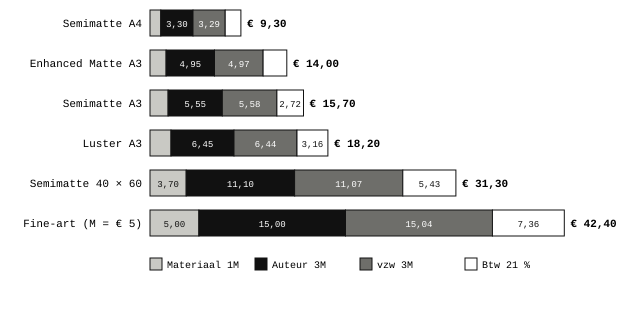
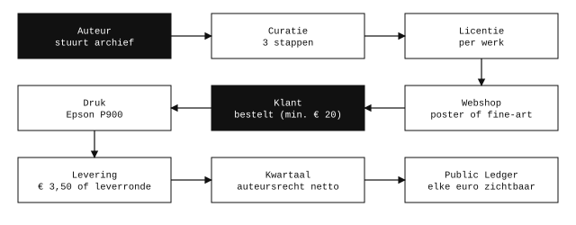
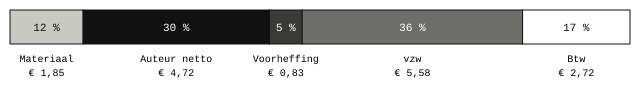
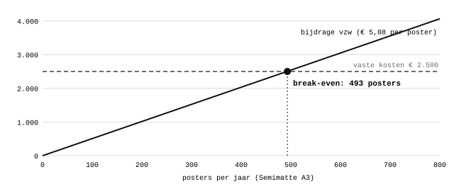
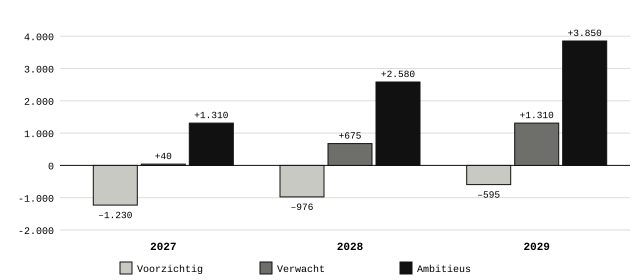
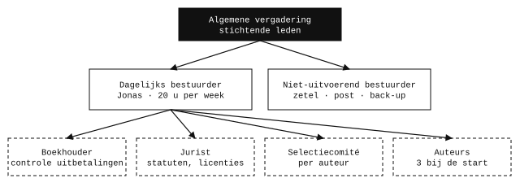
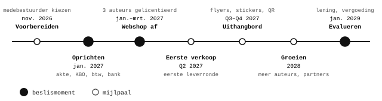

> **Correctie 2026-11-05 · Technieker.** Voor de postershop gelden de prijzen, maten en woorden uit [BESLISSINGEN.md](https://github.com/peapickers/postershoppeapickers/blob/main/BESLISSINGEN.md); die gaan voor op deze tekst. M = papier + inkt, zonder btw-opslag. Prijs = 7 × M, afgerond op € 0,10, zonder btw op de verkoop (vzw peapickers is btw-vrijgesteld). Verdeling 1 · 3 · 3: Materiaalkost 1M, Auteursrechten 3M bruto (min 15 % roerende voorheffing), vzw peapickers 3M bruto. Maten Klein 20 × 30, Medium 30 × 40 en Groot 40 × 60 cm, geen A-formaten meer. "Fine-art" heet nu Limited. De tekst hieronder blijft ongewijzigd staan als archief.

# Ondernemingsplan peapickers postershop 2027 – 2029

> Archiefversie. Nieuwste versie: [ondernemingsplan-2027-2029](ondernemingsplan-2027-2029.html).
>
> Versie 2 · 4 november 2026 · werkdocument, geen juridisch advies. Voor kandidaat-bestuurders en voor de andere projecten van peapickers.
>
> Elke aanname is gemarkeerd met [A1], [A2] … en staat in bijlage A. Namen en identiteitsgegevens zijn geanonimiseerd. Bedragen in euro.
>
> Kernkeuzes en wijzigingen: [ondernemingsplan](../ondernemingsplan.html). Dezelfde tekst als pdf: [ondernemingsplan-2027-2029-v2.pdf](ondernemingsplan-2027-2029-v2.pdf).

**Inhoud:** 1. Samenvatting · 2. Missie, visie en waarden · 3. Markt en omgeving · 4. Product en prijs · 5. Productie en logistiek · 6. Marketing en verkoop · 7. Auteurswerking · 8. Juridisch en administratie · 9. Financiën · 10. Organisatie en mensen · 11. Roadmap · 12. Risico's · 13. KPI's · Bijlage A. Aannames

## 1. Samenvatting

> **vzw peapickers opent in het voorjaar van 2027 een webshop met reproducties van werk van onafhankelijke kunstenaars. Elke prijs is ontleed tot op de cent, elke auteur wordt betaald in auteursrechten en elke euro staat in de Public Ledger.**

### vzw peapickers

vzw peapickers is de paraplunaam waaronder alle merken van peapickers vallen. Elk merk heeft hetzelfde sociaal-culturele hoofddoel: onafhankelijke kunstenaars als particulier, binnen hun statuut, zichtbaar maken in de fysieke en digitale structuur van de sociale en traditionele economie. Kort gezegd gebruiken we vooral het internet om (voornamelijk beeldende) kunstenaars zichtbaar te maken.

Voorlopig is de webshop peapickers postershop de enige hoofdactiviteit. Die kan organisch uitbreiden naar een digitaal archief, een culturele agenda (RSS-feed) en eventueel een nonprofit printshop. Later komen er hopelijk tentoonstellingen en B2B-afspraken bij.

Wat deze nonprofit uniek maakt, in de sociale én de traditionele economie, is een zo transparant mogelijk gedeconstrueerde prijs voor auteurs en klanten, en een volledig openbare administratie met geanonimiseerde persoonsgegevens. We geloven dat een open financieel beleid een gezondere economie kan brengen.

### peapickers postershop

De postershop verkoopt vanaf het voorjaar van 2027 reproducties van bestaande kunstwerken, gedrukt door peapickers en verzonden vanuit Gent. De auteur achter elke verkochte reproductie wordt per kwartaal betaald in auteursrechten.

| Kern           | Keuze                                                                                                               |
|----------------|---------------------------------------------------------------------------------------------------------------------|
| Rechtsvorm     | vzw peapickers, oprichting rond januari 2027, met minstens één medebestuurder                                       |
| Kanaal         | Alleen de webshop in 2027; in winkels, op expo's en op straat alleen flyers, stickers en kaartjes met QR-code       |
| Aanbod         | Posters op maat (7 × M, A4 tot 40 × 60 cm, drie papiersoorten) en gecureerde fine-art prints (7 × M, kleine oplage) |
| Voorbeeldprijs | Poster Semimatte A3 met passe-partout: € 15,70 incl. btw                                                            |
| Start          | 3 auteurs, 15 tot 30 werken; de oprichter werkt 20 uur per week                                                     |
| Break-even     | 493 posters per jaar (Semimatte A3) bij € 2.500 vaste kosten \[A1\]                                                 |
| Financiering   | Renteloze lening van de oprichter zonder termijn, kwijt te schelden. Nooit krediet.                                 |

## 2. Missie, visie en waarden

> **peapickers maakt werk van onafhankelijke beeldende kunstenaars zichtbaar en geeft hen met de postershop een economische kans, zonder dat hun statuut moet veranderen.**

### 2.1 Missie en visie

De naam verwijst naar Dorothea Langes foto *Destitute peapickers*, waar mensen net zoals 90 jaar geleden zonder inzetbare vaardigheden verbannen waren naar het uitvoeren van banaliteit in de maatschappij.

> Woekerwinsten en fraude vermijden, verantwoording afleggen. Een winstgedreven economie die schommelt tussen deels vrije markt en deels gecompartimentaliseerde verzorgingsstaat; afzwakken van subsidies, maar sterk houden van regelgeving in ondernemerschap; creatie van bureaucratische bullshitjobs gecombineerd met een consumentenmentaliteit; dagelijks volgestampt worden met reclame in elke mogelijke dimensie van de fysieke en digitale structuur van de maatschappij, gecombineerd met een staat die steeds meer controleert; het wegnemen van identiteit en burgerschap zonder er ooit over te praten, de normalisering van complete afhankelijkheid, zonder duidelijkheid waarvan we afhankelijk zijn; klagen over knopjes die van de twijg vallen terwijl de wortels van de boom met onverdunde chloor worden overgoten.

### 2.2 Ideologische kenmerken van peapickers

Deze kenmerken onderscheiden peapickers van de traditionele kunst- en postermarkt. Ze zijn niet onderhandelbaar en gelden voor elk merk.

1.  **Absolute financiële transparantie.** Elke prijs is ontleed tot op de cent. Elke ontvangst, uitgave, uitbetaling, lening en gift staat in de Public Ledger, zonder persoonsgegevens, ook de inbreng van de oprichter. Dit is de unieke invalshoek tegenover de concurrentie.
2.  **Solidariteit met wie maakt.** De auteur blijft eigenaar van werk en rechten, krijgt een vaste verdeling per verkoop en kan altijd stoppen.
3.  **Geen winst, geen schuld.** De vzw keert geen winst uit. Geen krediet en geen leverage, alleen een renteloze lening zonder termijn van de oprichter.
4.  **Privacy.** Geen tracking, geen klantgegevens op de site, geen betaalprovider, nooit cash.
5.  **Duurzaamheid.** Posters worden pas gedrukt na een bestelling, zonder overproductie, en geleverd in gedeelde leverrondes.
6.  **Veiligheid van het werk.** Online staan alleen kleine beelden met watermerk en bescherming tegen AI-training. Originelen komen nooit online.

## 3. Markt en omgeving

> **In 2027 verkoopt peapickers alleen online, vooral aan particulieren in Gent en omgeving.**

| Doelgroep | Wie                                                                                                                                                                                  |
|-----------|--------------------------------------------------------------------------------------------------------------------------------------------------------------------------------------|
| Posters   | Vooral in Gent, eerder jong, studerend in een artistieke richting of met sterke interesse in kunst en het esthetische. Bij elke nieuwe auteur ook diens vrienden- en kennissenkring. |
| Fine-art  | Eerst de kennissenkring, daarna een iets ouder publiek met koopkracht: kunstliefhebbers, mensen die nonprofits steunen en verzamelaars die een investering hopen te doen.            |
| Auteurs   | Makers zonder professioneel statuut en zonder kunstenaarsattest, 18 jaar of ouder, wonend in België.                                                                                 |

**Concurrenten en partners.** Gewone posterwinkels en online printshops verkopen goedkoper of bekender werk, zonder open prijs. Gentse initiatieven zoals kunstwerkplaatsen en copyshops zijn eerder mogelijke nonprofitpartners: zij kunnen hun werk op de site tonen en er reproducties van laten verkopen met een gelijkaardige prijsverdeling. Eerder dan in winkels te verkopen, probeert peapickers zulke volledige assortimenten op te nemen.

## 4. Product en prijs

> **Er zijn twee producten met dezelfde prijsformule: posters op maat, gedrukt na bestelling, en gecureerde fine-art prints in kleine oplage. Altijd 7 × M, verdeeld als 1 materiaal, 3 auteur en 3 vzw.**

> **prijs incl. btw = 7 × M × 1,21, afgerond op € 0,10  
> (1 M materiaal · 3 M auteur (bruto) · 3 M vzw (± afronding))**

### 4.1 Posters op maat

Elk werk in de shop is als poster verkrijgbaar. De klant kiest in drie stappen, en ziet altijd de berekening van M en de prijs:

1.  **Velgrootte:** van A4 tot 40 × 60 cm, met schuivers per centimeter, verhouding van 4:6 tot 1:1. Tip: meet je kader of plek op de muur.
2.  **Afbeeldingsgrootte:** de passe-partout is de witruimte op het vel rond de afbeelding, per centimeter in te stellen.
3.  **Aantal**, en de instellingen kopiëren naar de volgende poster.

M = velkost + inktkost. De velkost volgt het kleinste A-formaat waarin het vel past, de inktkost het kleinste A-formaat waarin de afbeelding past. Tot 40 × 60 cm geldt het A2-tarief.

| Velkost per papier         | A4   | A3   | A2   |
|----------------------------|------|------|------|
| Epson Enhanced Matte 189 g | 0,50 | 1,00 | 2,00 |
| Epson Semimatte 260 g      | 0,60 | 1,20 | 2,40 |
| Epson Luster 260 g         | 0,75 | 1,50 | 3,00 |
| Inktkost per afbeelding    | 0,50 | 0,65 | 1,30 |

**Prijzen incl. btw** als vel en afbeelding in hetzelfde formaat vallen. Een kleinere afbeelding is iets goedkoper.

| Papier               | Tot A4               | Tot A3               | Tot 40 × 60 cm       |
|----------------------|----------------------|----------------------|----------------------|
| Enhanced Matte 189 g | € 8,50 (M = € 1,00)  | € 14,00 (M = € 1,65) | € 28,00 (M = € 3,30) |
| Semimatte 260 g      | € 9,30 (M = € 1,10)  | € 15,70 (M = € 1,85) | € 31,30 (M = € 3,70) |
| Luster 260 g         | € 10,60 (M = € 1,25) | € 18,20 (M = € 2,15) | € 36,40 (M = € 4,30) |

*Prijsopbouw per stuk in euro: materiaal, auteur, vzw en btw. Fine-art met M = € 5 als voorbeeld \[A4\].*

### 4.2 Fine-art

Unieke prints, op duur papier of op een bijzondere manier gereproduceerd, in een selectieve, gecureerde oplage, genummerd en gesigneerd door de auteur. De klant kiest geen formaat: het is een vaste print met een vaste prijs van 7 × M, en M verschilt per werk. Fine-art is voorraad. De auteursrechten worden meteen bij het drukken uitbetaald, nog voor de verkoop. Daarom komt een fine-art pas online als de vzw dat kan betalen.

### 4.3 Curatie

1.  De auteur maakt een eigen voorselectie; een groter archief mag gerust doorgestuurd worden.
2.  peapickers selecteert op harde criteria (de checkpunten van Join peapickers).
3.  peapickers selecteert daarna samen met de auteur. De gekozen werken worden gelicentieerd en als poster te koop aangeboden.

Fine-art wordt alleen door peapickers voorgesteld, gecureerd met het grotere team en eventueel uitbesteed aan de beste of interessantste reproductievorm. Dat komt in een nieuwe licentie, tenzij al bij de eerste selectie vaststaat dat een werk eruit springt.

Er zijn geen kaders, latten of passe-partouts als apart product.

## 5. Productie en logistiek

> **De oprichter drukt thuis op een Epson P900 met ongeveer 300 A3 per maand, ruim boven de 41 per maand die het break-even vraagt.**

- **Printer en materiaal.** Epson P900, papier Enhanced Matte, Luster en Semimatte. De bestaande printer, inkt en papiervoorraad zijn een gift van de oprichter aan de vzw. Nieuw materiaal en nieuwe hardware koopt de vzw met haar opbrengsten; ze worden nooit privé gebruikt.
- **Plaats.** Printer en voorraad staan op het privéadres van de oprichter, niet op de zetel. Woonkosten (huur, energie, internet) worden nooit ingebracht.
- **Voorraad.** Posters worden pas gedrukt na bestelling. Fine-art is voorraad, bewaard waar gedrukt wordt, tenzij de wet of de fiscus het adres van de vzw vereist.
- **Verpakking.** € 0,50 per poster, € 1,50 per fine-art \[A2\]. Voorstel: het inpakken filmen als bewijs bij transportschade.

### 5.1 Bestellen en leveren

| Regel               | Wat                                                                                                                                                                              |
|---------------------|----------------------------------------------------------------------------------------------------------------------------------------------------------------------------------|
| Bestelminimum       | € 20 in de mand, zonder leverkost                                                                                                                                                |
| Leverkost           | € 3,50 incl. btw, vast. Geen gratis verzending.                                                                                                                                  |
| Gedeelde leverronde | Aparte, gratis dienst voor Gent en deelgemeenten. De ronde vertrekt bij 5 aanmeldingen of na hoogstens 14 dagen. De site toont hoeveel mensen wachten en wanneer de ronde sluit. |
| Buiten Gent         | Via bpost; tarieven nog niet bepaald \[A9\]                                                                                                                                      |

## 6. Marketing en verkoop

> **In 2027 is er één verkoopkanaal: de webshop. Alles wat fysiek is, verwijst ernaar.**

1.  **Webshop af** tussen januari en maart 2027. Pas dan begint de verkoop.
2.  **Fysiek uithangbord:** flyers, stickers en kaartjes met QR-code in winkels, op expo's en op straat. We meten of het verkeer op de webshop stijgt.
3.  **Later in de winkel,** pas als de webshop goed loopt, met een nieuwe licentie per werk en een aparte winkelprijs waarin de commissie van de winkel bovenop de webshopprijs komt.

**Budget.** Ten hoogste € 50 per maand voor alle marketing: flyers, stalen, stickers, SEO, standplaatsen op markten en andere niet-invasieve reclame. De oprichter stort het bedrag maandelijks.

## 7. Auteurswerking

> **De auteur tekent per werk een niet-exclusieve licentie en krijgt 3 van de 7 delen, netto uitbetaald per kwartaal.**

*De weg van een werk, van auteur tot klant en terug naar de auteur.*

1.  **Werving** via het eigen netwerk, lokale plekken en doorverwijzing. Start met 3 auteurs en 15 tot 30 werken.
2.  **Aanmelden** per mail met beelden in lage resolutie. Nooit tekenen tijdens het eerste gesprek; gratis advies bij Cultuurloket.
3.  **Licentie** per werk, voor poster en/of fine-art. Posterlicentie voor 1 jaar, telkens verlengbaar na schriftelijke bevestiging. De licentie maakt duidelijk dat auteur, maker en kunstenaar hetzelfde betekenen.
4.  **Uitbetaling.** De vzw houdt 15 % roerende voorheffing in en stort die door. Voorstel: de boekhouder controleert bedragen en rekeningnummers, de dagelijks bestuurder betaalt uit.
5.  **Opvolging.** Elke verkoop staat met de werkcode in de Public Ledger. Stoppen kan altijd: binnen 7 dagen staat het werk offline.

| Per verkocht stuk   | Prijs incl. btw | Auteur bruto | Voorheffing 15 % | Auteur netto |
|---------------------|-----------------|--------------|------------------|--------------|
| Poster Semimatte A3 | € 15,70         | € 5,55       | € 0,83           | € 4,72       |
| Fine-art, M = € 5   | € 42,40         | € 15,00      | € 2,25           | € 12,75      |

**Fine-art en reserve.** Een fine-art komt pas online als de vzw de auteursrechten bij het drukken kan betalen: zodra de reserve één jaar vaste kosten dekt (€ 2.500), of als de oprichter of een investeerder daarvoor apart geld stort. Ook dat is nooit krediet; die lening moet kwijtgescholden kunnen worden.

## 8. Juridisch en administratie

> **De vzw wordt rond januari 2027 opgericht met een onderhandse akte, zonder notaris, door de oprichter en minstens één medebestuurder.**

### 8.1 Wat we van een medebestuurder vragen

De rol is zo klein mogelijk: een **niet-uitvoerend bestuurder** zonder dagelijks bestuur, die ook stichtend lid is. Er zijn vier kandidaten.

- de **maatschappelijke zetel** ter beschikking stellen en officiële post ontvangen; de zetel bevat alleen een administratieve kast en een externe, versleutelde schijf;
- **bewaarnemer** van de externe back-upschijf, en die bijwerken bij elk nieuw stuk;
- de wettelijke minima: algemene vergadering, jaarrekening en begroting goedkeuren, UBO-register;
- mee beslissen over de punten die alle bestuurders goedkeuren (hieronder).

De oprichter is **dagelijks bestuurder** en voert alles uit. **Alle bestuurders** keuren goed: (1) hardware zoals printer, scanner, reproductiemateriaal, lampen, laptop of fiets; (2) juridische of gespecialiseerde diensten; (3) de keuze van auteurs, hun werken en de reproductievorm. Dagelijkse uitgaven zoals inkt en papier voor reeds gelicentieerde reproducties niet.

### 8.2 Stappen bij de oprichting

1.  Medebestuurder(s) kiezen.
2.  Statuten opstellen; een jurist (Lann, J.) leest statuten en licenties na.
3.  Akte tekenen, neerleggen bij de griffie, publicatie in het Belgisch Staatsblad (ca. € 170) \[A7\].
4.  Ondernemingsnummer, btw-registratie (altijd 21 %), UBO-register.
5.  Bankrekening op naam van de vzw, verzekeringen afsluiten.
6.  Renteloze lening en gift schriftelijk vastleggen.

### 8.3 Andere afspraken

- **Vermogen bij ontbinding:** voorstel naar een vzw met een gelijkaardig doel, aan te duiden door de algemene vergadering.
- **Verzekeringen:** BA uitbating en bestuurdersaansprakelijkheid, samen naar schatting € 350 tot 750 per jaar \[A8\].
- **Herroeping:** 14 dagen geldt waarschijnlijk voor alles; een uitzondering voor gesigneerde fine-art is wenselijk als de wet het toelaat \[A10\].
- **Privacy en belangen:** geen klantgegevens op de site; bestuurders en hun familie kunnen geen auteur zijn.

## 9. Financiën

> **Met 493 posters per jaar dekt de vzw haar vaste kosten. In het voorzichtige scenario vraagt ze over drie jaar ongeveer € 2.801 aan renteloze lening.**

### 9.1 Waar gaat elke euro naartoe?

*Verdeling van € 15,70 voor een poster Semimatte A3 met passe-partout (M = € 1,85, 7M = € 12,95, afgerond € 12,98 excl. btw).*

### 9.2 Break-even

Per poster Semimatte A3 houdt de vzw € 5,58 over, min € 0,50 verpakking: € 5,08. Bij € 2.500 vaste kosten per jaar \[A1\] is het break-even 493 posters per jaar, ongeveer 41 per maand. Elke fine-art van € 42,40 brengt na verpakking € 13,54 op en verlaagt dat getal met ongeveer drie posters.

*Bijdrage van de vzw tegenover de vaste kosten.*

### 9.3 Scenario's over drie jaar

Er is geen meting van de vraag. De scenario's rekenen met een gemiddelde poster (Semimatte A3), zonder fine-art \[A5\].

*Resultaat na vaste kosten per jaar, in euro.*

| Scenario    | Posters 2027 | 2028 | 2029 | Resultaat 2027 | 2028   | 2029   | 3 jaar     |
|-------------|--------------|------|------|----------------|--------|--------|------------|
| Voorzichtig | 250          | 300  | 375  | –1.230         | –976   | –595   | **–2.801** |
| Verwacht    | 500          | 625  | 750  | +40            | +675   | +1.310 | **+2.025** |
| Ambitieus   | 750          | 1000 | 1250 | +1.310         | +2.580 | +3.850 | **+7.740** |

In het verwachte scenario bedraagt de omzet in 2027 ongeveer € 6.490 excl. btw en krijgen de auteurs samen € 2.775 bruto. In 2029 is dat € 4.162.

### 9.4 Startkosten en financiering

| Post                                    | Bedrag                     |
|-----------------------------------------|----------------------------|
| Publicatie oprichting in het Staatsblad | ca. € 170 \[A7\]           |
| Ondernemingsnummer, btw, UBO-register   | € 0                        |
| Jurist (statuten en licenties)          | offerte                    |
| Verzekeringen, eerste jaar              | € 350 tot 750 \[A8\]       |
| Printer, inkt en papier                 | € 0, gift van de oprichter |
| **Totaal zonder jurist**                | **ca. € 520 tot 920**      |

**Financiering.** Alleen eigen middelen: een renteloze lening van de oprichter voor de startkosten en de vaste kosten (boekhouder, jurist), zonder vaste terugbetalingstermijn. Ze wordt pas terugbetaald als de vzw genoeg reserve heeft, zonder druk, en ze mag worden kwijtgescholden. Geen krediet. Subsidies en crowdfunding kunnen later.

## 10. Organisatie en mensen

> **De oprichter doet het werk, 20 uur per week. De rest van de organisatie bestaat uit kleine, duidelijke rollen.**

*Organisatie bij de start. Gestippeld: externe of wisselende rollen.*

- **Bij uitval van de oprichter** wordt de webshop tijdelijk stilgezet.
- **Vergoeding van de oprichter:** eerst wordt de lening terugbetaald; over een vergoeding wordt pas vanaf januari 2029 nagedacht.

## 11. Roadmap

> **Drie fases met elk een beslismoment: oprichten, verkopen, groeien.**

| Periode        | Mijlpaal                                                                                        | Beslismoment                                          |
|----------------|-------------------------------------------------------------------------------------------------|-------------------------------------------------------|
| Nov.–dec. 2026 | Medebestuurder gekozen, statuten en licenties in concept                                        | Wie wordt medebestuurder?                             |
| Jan. 2027      | Akte, ondernemingsnummer, btw, UBO, bankrekening, verzekering                                   | Statuten goedgekeurd door de jurist                   |
| Jan.–mrt. 2027 | Webshop af, 3 auteurs gelicentieerd, stalen gedrukt                                             | Is de webshop klaar voor verkoop?                     |
| Q2 2027        | Eerste bestelling, eerste leverronde, eerste kwartaaluitbetaling in juli                        |                                                       |
| Q3–Q4 2027     | Flyers, stickers en QR-codes in de stad; effect gemeten                                         | Werkt het fysieke uithangbord?                        |
| 2028           | Meer auteurs (doel 6 tot 10, hopelijk veel meer), nonprofitpartners op de site, eerste fine-art | Verkoop in winkels proberen?                          |
| Jan. 2029      | Drie jaar cijfers                                                                               | Lening terugbetalen, vergoeding oprichter, eigen pand |

## 12. Risico's

> **Het grootste risico is te weinig verkoop. De lening zonder termijn vangt dat op, zonder schulden bij derden.**

| Risico                                | Kans   | Gevolg                          | Wat dan                                             |
|---------------------------------------|--------|---------------------------------|-----------------------------------------------------|
| Te weinig verkoop                     | Middel | Tekort tot ca. € 1.230 per jaar | Renteloze lening; vaste kosten herbekijken          |
| Uitval van de oprichter               | Middel | Geen productie                  | Webshop tijdelijk stilzetten                        |
| Geen medebestuurder in januari        | Middel | Oprichting schuift op           | Verkoop schuift mee; niets verkopen zonder vzw      |
| Licentie of herroeping juridisch fout | Laag   | Geschil                         | Jurist leest na vóór de eerste verkoop              |
| Btw- of voorheffingsfout              | Laag   | Boete                           | Boekhouder controleert elke kwartaaluitbetaling     |
| Druk- of transportschade              | Middel | Kosten, reputatie               | Inpakken filmen; verzekering                        |
| Auteur stopt                          | Middel | Werk offline binnen 7 dagen     | Meerdere auteurs; licentie per werk                 |
| Verlies van bestanden                 | Laag   | Originelen weg                  | Twee versleutelde schijven en een kopie buitenshuis |

## 13. KPI's

> **Per departement een paar getallen, elk kwartaal te volgen in de Public Ledger. Ze volgen het verwachte scenario.**

| Departement   | KPI                           | 2027      | 2028    | 2029     |
|---------------|-------------------------------|-----------|---------|----------|
| Product       | Werken in de shop             | 15 tot 30 | 40      | 60       |
| Verkoop       | Posters per jaar              | 500       | 625     | 750      |
| Auteurs       | Auteurs met licentie          | 3         | 6       | 10       |
| Auteurs       | Uitbetaald bruto              | € 2.775   | € 3.469 | € 4.162  |
| Productie     | Levering binnen 14 dagen      | 95 %      | 95 %    | 95 %     |
| Marketing     | Plekken met flyer of QR-code  | 3         | 6       | 8        |
| Financiën     | Resultaat na vaste kosten     | ≥ 0       | \+ 675  | \+ 1.310 |
| Administratie | Kwartaaluitbetalingen op tijd | 100 %     | 100 %   | 100 %    |

## Bijlage A. Aannames

| \#  | Aanname                                                                                                            | Bron                                                                             |
|-----|--------------------------------------------------------------------------------------------------------------------|----------------------------------------------------------------------------------|
| A1  | Vaste kosten ongeveer € 2.500 per jaar                                                                             | Dossier voor de boekhouder; nog te controleren                                   |
| A2  | Verpakking € 0,50 per poster, € 1,50 per fine-art                                                                  | Dossier voor de boekhouder                                                       |
| A4  | Fine-art met M = € 5 als rekenvoorbeeld                                                                            | Prijsschema postershop                                                           |
| A5  | Scenario's: 250 / 500 / 750 posters in 2027, groei tot 375 / 750 / 1.250 in 2029; gemiddelde poster = Semimatte A3 | Rekenbasis goedgekeurd door de oprichter; de aantallen zijn een gok, geen meting |
| A7  | Publicatie oprichting ca. € 170                                                                                    | Uit geheugen, niet nagekeken                                                     |
| A8  | Verzekeringen € 350 tot 750 per jaar                                                                               | Ordegrootte, offertes vragen                                                     |
| A9  | Bpost-tarieven niet in de cijfers                                                                                  | Open                                                                             |
| A10 | Herroeping 14 dagen geldt waarschijnlijk ook voor fine-art                                                         | Te bevestigen door de jurist                                                     |

### Bronnen

- peapickers.github.io, projectpagina's Postershop, Werkwijze, Ondernemingsplan, Marketing en het dossier voor de boekhouder
- postershoppeapickers: pagina's Fiscaliteit en Join peapickers, licentieovereenkomst concept 4
- Ondernemingsplan Peapickers Archief v3.1 (30-10-2026)
- Vragenlijsten ondernemingsplan v1 en v2 en antwoorden van de oprichter (2 tot 4 november 2026)
