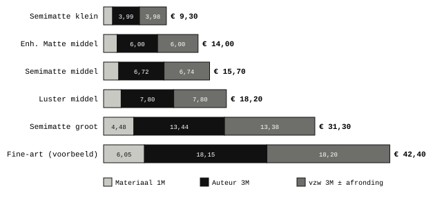
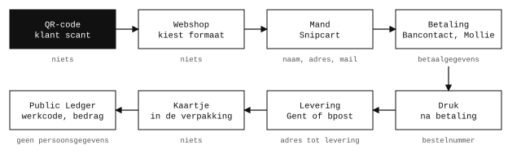
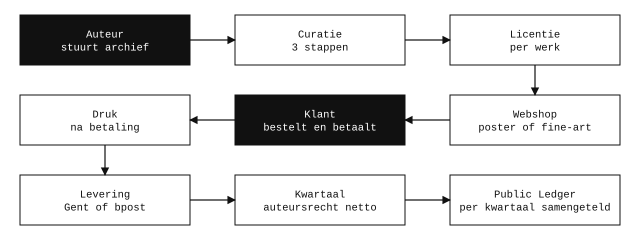
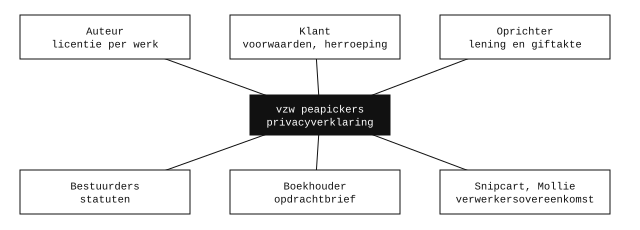
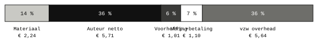
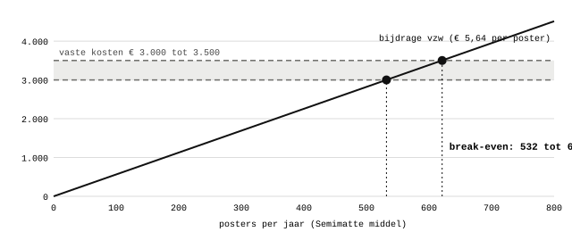
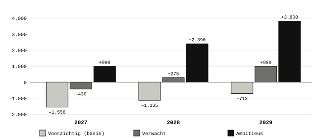
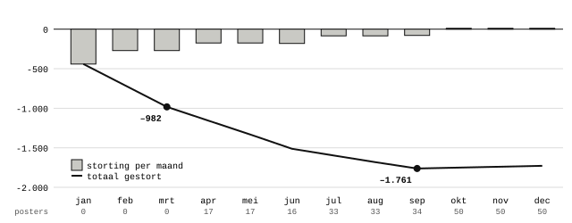
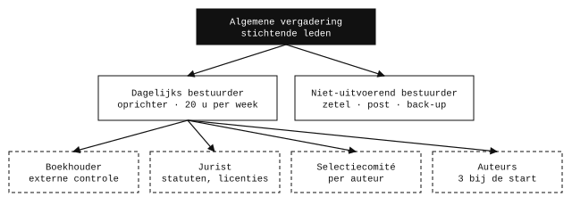
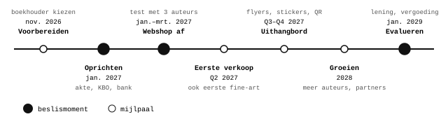

> **Correctie 2026-11-05 · Technieker.** Voor de postershop gelden de prijzen, maten en woorden uit [BESLISSINGEN.md](https://github.com/peapickers/postershoppeapickers/blob/main/BESLISSINGEN.md); die gaan voor op deze tekst. M = papier + inkt, zonder btw-opslag. Prijs = 7 × M, afgerond op € 0,10, zonder btw op de verkoop (vzw peapickers is btw-vrijgesteld). Verdeling 1 · 3 · 3: Materiaalkost 1M, Auteursrechten 3M bruto (min 15 % roerende voorheffing), vzw peapickers 3M bruto. Maten Klein 20 × 30, Medium 30 × 40 en Groot 40 × 60 cm, geen A-formaten meer. "Fine-art" heet nu Limited. De tekst hieronder blijft ongewijzigd staan als archief.

# Ondernemingsplan peapickers postershop 2027 – 2029

> Versie 3 · 4 november 2026 · werkdocument, geen juridisch advies. Voor kandidaat-bestuurders en voor de andere projecten van peapickers.
>
> Verwerkt de feedback van jurist, boekhouder, techniek en marketing en de antwoorden van de oprichter op vragenlijst v3. Elke aanname is gemarkeerd met [A1], [A2] … en staat in bijlage A. Namen en identiteitsgegevens zijn geanonimiseerd. Bedragen in euro.
>
> Kernkeuzes en wijzigingen: [ondernemingsplan](../ondernemingsplan.html) · Stappenplannen: [stappenplannen](stappenplannen.html) · Pdf: [ondernemingsplan-2027-2029-v3.pdf](ondernemingsplan-2027-2029-v3.pdf) · Vorige versie: [v2](ondernemingsplan-2027-2029-v2.html)

**Inhoud:** 1. Samenvatting · 2. Missie, visie en waarden · 3. Markt en omgeving · 4. Product en prijs · 5. Productie en logistiek · 6. Marketing en verkoop · 7. Auteurswerking · 8. Juridisch en administratie · 9. Financiën · 10. Organisatie en mensen · 11. Roadmap · 12. Risico's · 13. KPI's · 14. Wat er nog moet gebeuren · Bijlage A. Aannames

## 1. Samenvatting

> **vzw peapickers opent in het voorjaar van 2027 een webshop met reproducties van werk van onafhankelijke kunstenaars. Elke prijs is ontleed tot op de cent, elke auteur wordt betaald in auteursrechten en elke euro staat in de Public Ledger.**

### vzw peapickers

vzw peapickers is de paraplunaam waaronder alle merken van peapickers vallen. Elk merk heeft hetzelfde sociaal-culturele hoofddoel: onafhankelijke kunstenaars als particulier, binnen hun statuut, zichtbaar maken in de fysieke en digitale structuur van de sociale en traditionele economie. Kort gezegd gebruiken we vooral het internet om (voornamelijk beeldende) kunstenaars zichtbaar te maken.

Voorlopig is de webshop peapickers postershop de enige hoofdactiviteit. Die kan organisch uitbreiden naar een digitaal archief, een culturele agenda (RSS-feed) en later een nonprofit printshop. Later komen er hopelijk tentoonstellingen en B2B-afspraken bij.

Wat deze nonprofit uniek maakt, in de sociale én de traditionele economie, is een zo transparant mogelijk gedeconstrueerde prijs voor auteurs en klanten, en een volledig openbare administratie met geanonimiseerde persoonsgegevens. We geloven dat een open financieel beleid een gezondere economie kan brengen.

### peapickers postershop

De postershop verkoopt vanaf het voorjaar van 2027 reproducties van bestaande kunstwerken, gedrukt door peapickers en verzonden vanuit Gent. De auteur achter elke verkochte reproductie wordt per kwartaal betaald in auteursrechten.

| Kern           | Keuze                                                                                                                                                                |
|----------------|----------------------------------------------------------------------------------------------------------------------------------------------------------------------|
| Rechtsvorm     | vzw peapickers, oprichting rond januari 2027, met minstens één medebestuurder. Vennootschapsbelasting; btw-vrijgesteld als kleine onderneming (omzet onder € 25.000) |
| Kanaal         | Alleen de webshop in 2027; in winkels, op markten en op straat alleen flyers, stickers en kaartjes met QR-code                                                       |
| Aanbod         | Posters op maat (7 × M, van 21 × 29,7 tot 40 × 60 cm, drie papiersoorten) en gecureerde fine-art prints (7 × M, kleine oplage), allebei vanaf de start               |
| Voorbeeldprijs | Poster Semimatte, middel (tot 29,7 × 42 cm): € 15,70, waarvan € 6,72 voor de auteur                                                                                  |
| Start          | 3 auteurs, 15 tot 30 werken; de oprichter werkt 20 uur per week                                                                                                      |
| Break-even     | 532 tot 621 posters per jaar bij € 3.000 tot 3.500 vaste kosten \[A1\]                                                                                               |
| Financiering   | De oprichter stort elke maand precies wat nodig is, als renteloze, achtergestelde lening die kwijtgescholden kan worden. Geen reserve, nooit krediet.                |

## 2. Missie, visie en waarden

> **peapickers maakt werk van onafhankelijke beeldende kunstenaars zichtbaar en geeft hen met de postershop een economische kans, zonder dat hun statuut moet veranderen.**

Dat laatste is besproken met de jurist (Lann, J.): de licentie bevestigt dat het werk zonder invloed van peapickers gemaakt is en alleen als reproductie verkocht wordt, niet in opdracht. Het jaarbedrag dat een particulier in auteursrechten mag ontvangen, wordt met reproducties niet bereikt.

### 2.1 Missie en visie

De naam verwijst naar Dorothea Langes foto *Destitute peapickers*, waar mensen net zoals 90 jaar geleden zonder inzetbare vaardigheden verbannen waren naar het uitvoeren van banaliteit in de maatschappij.

> Woekerwinsten en fraude vermijden, verantwoording afleggen. Een winstgedreven economie die schommelt tussen deels vrije markt en deels gecompartimentaliseerde verzorgingsstaat; afzwakken van subsidies, maar sterk houden van regelgeving in ondernemerschap; creatie van bureaucratische bullshitjobs gecombineerd met een consumentenmentaliteit; dagelijks volgestampt worden met reclame in elke mogelijke dimensie van de fysieke en digitale structuur van de maatschappij, gecombineerd met een staat die steeds meer controleert; het wegnemen van identiteit en burgerschap zonder er ooit over te praten, de normalisering van complete afhankelijkheid, zonder duidelijkheid waarvan we afhankelijk zijn; klagen over knopjes die van de twijg vallen terwijl de wortels van de boom met onverdunde chloor worden overgoten.

Dit manifest blijft voor het plan en voor bestuurders. Klanten krijgen een korte, positieve versie van twee zinnen.

### 2.2 Ideologische kenmerken van peapickers

Deze kenmerken onderscheiden peapickers van de traditionele kunst- en postermarkt. Ze zijn niet onderhandelbaar en gelden voor elk merk.

1.  **Absolute financiële transparantie.** Elke prijs is ontleed tot op de cent. Elke ontvangst, uitgave, lening en gift staat in de Public Ledger, ook de inbreng van de oprichter. Verkopen staan er per werkcode, zonder persoonsgegevens; uitbetalingen aan auteurs staan er per kwartaal samengeteld over alle auteurs, zodat niemands inkomen af te leiden is. Dit is de unieke invalshoek tegenover de concurrentie.
2.  **Solidariteit met wie maakt.** De auteur blijft eigenaar van werk en rechten, krijgt een vaste verdeling per verkoop en kan altijd stoppen.
3.  **Geen winst, geen schuld.** De vzw keert geen winst uit. Geen krediet en geen leverage, alleen een renteloze lening van de oprichter. Het deel van de vzw betaalt de overheadkosten.
4.  **Privacy.** Geen tracking en geen eigen klantendatabase. De mand (Snipcart) en de betaling (Mollie, Bancontact) zijn externe diensten met een verwerkersovereenkomst; gegevens worden alleen bewaard zolang de levering en de wet het vragen. Nooit cash.
5.  **Duurzaamheid.** Posters worden pas gedrukt na een bestelling, zonder overproductie, en geleverd in gedeelde leverrondes.
6.  **Veiligheid van het werk.** Het originele bestand wordt nooit bewerkt en komt nooit online; daarvan worden de afdrukken gemaakt. Wat wel online staat (weergave van 1200 px en thumbnail), krijgt een watermerk en Glaze, zoals in de licentie staat. Zoekmachines en AI-crawlers worden gevraagd weg te blijven (robots.txt en een voorbehoud in de footer); dat is een poging, geen garantie.

## 3. Markt en omgeving

> **In 2027 verkoopt peapickers alleen online, vooral aan particulieren in Gent en omgeving, in het Nederlands en het Engels.**

| Doelgroep | Wie                                                                                                                                                                                                                |
|-----------|--------------------------------------------------------------------------------------------------------------------------------------------------------------------------------------------------------------------|
| Posters   | Vooral in Gent, eerder jong, studerend in een artistieke richting of met sterke interesse in kunst en het esthetische, ook internationale studenten. Bij elke nieuwe auteur ook diens vrienden- en kennissenkring. |
| Fine-art  | Eerst de kennissenkring, daarna een iets ouder publiek met koopkracht: kunstliefhebbers, mensen die nonprofits steunen en verzamelaars die een investering hopen te doen.                                          |
| Auteurs   | Makers zonder professioneel statuut en zonder kunstenaarsattest, 18 jaar of ouder, wonend in België.                                                                                                               |

**Concurrenten en partners.** Grote online posterwinkels vragen vergelijkbare prijzen. Het verschil zit niet in de prijs maar in het werk van een lokale auteur, het formaat op maat en de open prijs. Gentse initiatieven zoals kunstwerkplaatsen en copyshops zijn eerder mogelijke nonprofitpartners: zij kunnen hun werk op de site tonen en er reproducties van laten verkopen met een gelijkaardige prijsverdeling.

## 4. Product en prijs

> **Twee producten met dezelfde formule: posters op maat, gedrukt na bestelling, en gecureerde fine-art prints in kleine oplage. Altijd 7 × M: 1 materiaal, 3 auteur, 3 vzw. De vzw is btw-vrijgesteld, dus er komt geen btw bovenop.**

> **prijs = 7 × M, afgerond op € 0,10 (M = velkost + inktkost, inclusief de btw die de vzw zelf op het materiaal betaalt · 1 M materiaal · 3 M auteur (bruto) · 3 M vzw (± afronding))**

Omdat de vzw de btw op papier en inkt niet terugkrijgt, telt die btw mee in M. De prijzen voor de klant blijven daardoor gelijk aan die van versie 2; wat vroeger btw op de verkoop was, gaat nu naar de auteur en de vzw. Op de site en de factuur staat "btw-vrijgesteld (bijzondere vrijstellingsregeling kleine ondernemingen)". Gaat de omzet boven € 25.000, dan moet de verdeling opnieuw bekeken worden.

### 4.1 Posters op maat

Elk werk in de shop is als poster verkrijgbaar. De klant kiest in drie stappen, en ziet altijd de berekening van M en de prijs, met een strook die toont hoeveel naar de auteur gaat:

1.  **Velgrootte:** van 21 × 29,7 tot 40 × 60 cm, met schuivers per centimeter, verhouding van 4:6 tot 1:1. Het papier komt van een rol van 40 cm breed; 40 × 60 cm is het maximum. Tip: meet je kader of plek op de muur.
2.  **Afbeeldingsgrootte:** de passe-partout is de witruimte op het vel rond de afbeelding, per centimeter in te stellen.
3.  **Aantal**, en de instellingen kopiëren naar de volgende poster.

De velkost volgt de kleinste van drie groottes waarin het vel past, de inktkost de kleinste waarin de afbeelding past: klein (tot 21 × 29,7 cm), middel (tot 29,7 × 42 cm) en groot (tot 40 × 60 cm).

| Inkoop excl. btw           | Klein | Middel | Groot |
|----------------------------|-------|--------|-------|
| Epson Enhanced Matte 189 g | 0,50  | 1,00   | 2,00  |
| Epson Semimatte 260 g      | 0,60  | 1,20   | 2,40  |
| Epson Luster 260 g         | 0,75  | 1,50   | 3,00  |
| Inkt per afbeelding        | 0,50  | 0,65   | 1,30  |

| M incl. btw op materiaal | Klein tot 21 × 29,7 cm | Middel tot 29,7 × 42 cm | Groot tot 40 × 60 cm |
|--------------------------|------------------------|-------------------------|----------------------|
| Enhanced Matte 189 g     | 1,21                   | 2,00                    | 3,99                 |
| Semimatte 260 g          | 1,33                   | 2,24                    | 4,48                 |
| Luster 260 g             | 1,51                   | 2,60                    | 5,20                 |

**Prijzen voor de klant** als vel en afbeelding in dezelfde grootte vallen. Een kleinere afbeelding is iets goedkoper. De prijs rekent met de onafgeronde M; daardoor kan 7 × de getoonde M een paar cent afwijken. Dat verschil gaat naar of komt van de vzw.

| Prijs voor de klant  | Klein tot 21 × 29,7 cm | Middel tot 29,7 × 42 cm | Groot tot 40 × 60 cm |
|----------------------|------------------------|-------------------------|----------------------|
| Enhanced Matte 189 g | € 8,50                 | € 14,00                 | € 28,00              |
| Semimatte 260 g      | € 9,30                 | € 15,70                 | € 31,30              |
| Luster 260 g         | € 10,60                | € 18,20                 | € 36,40              |

*Prijsopbouw per stuk in euro: materiaal, auteur en vzw. Geen btw op de verkoop. Fine-art met een inkoop van € 5 als voorbeeld \[A4\].*

### 4.2 Fine-art

Unieke prints, op duur papier of op een bijzondere manier gereproduceerd, in een selectieve, gecureerde oplage, genummerd en gesigneerd door de auteur. De klant kiest geen formaat: het is een vaste print met een vaste prijs van 7 × M, en M verschilt per werk. Fine-art is voorraad. De auteursrechten worden meteen bij het drukken uitbetaald, nog voor de verkoop.

Fine-art komt al in de eerste maanden aan bod: er zijn te veel mooie werken om geen speciale oplages te maken. De oprichter stort het geld voor druk en auteursrechten als lening, die later kwijtgescholden kan worden. De licentie regelt wat er gebeurt met onverkochte of beschadigde exemplaren. Onverkochte exemplaren zijn voorraad, gewaardeerd aan materiaal plus betaalde auteursrechten, en worden op de laatste dag van het boekjaar geteld.

### 4.3 Curatie

1.  De auteur maakt een eigen voorselectie; een groter archief mag gerust doorgestuurd worden.
2.  peapickers selecteert op harde criteria (de checkpunten van Join peapickers).
3.  peapickers selecteert daarna samen met de auteur. De gekozen werken worden gelicentieerd en als poster te koop aangeboden.

De redenering van het selectiecomité blijft privé, ook bij afgewezen werk. Publiek komen alleen de werken en, als die er is, de geschreven context van de auteur. Fine-art wordt alleen door peapickers voorgesteld, gecureerd met het grotere team en eventueel uitbesteed aan de beste reproductievorm.

Er zijn geen kaders, latten of passe-partouts als apart product. Werken uit het publiek domein worden niet verkocht.

## 5. Productie en logistiek

> **De oprichter drukt thuis op een Epson P900 met ongeveer 300 posters per maand, ruim boven de 44 tot 52 per maand die het break-even vraagt.**

- **Printer en materiaal.** De bestaande printer, inkt en papiervoorraad worden met een giftakte aan de vzw geschonken, met inventaris, foto's en marktwaarde, zodat de vzw de printer kan afschrijven en als eigendom kan aantonen. Nieuw materiaal en nieuwe hardware koopt de vzw; ze worden nooit privé gebruikt.
- **Plaats.** Printer en voorraad staan op het privéadres van de oprichter, niet op de zetel. Woonkosten worden nooit ingebracht. Het materiaal van de vzw wordt apart verzekerd.
- **Voorraad.** Posters worden pas gedrukt na betaling. Fine-art is voorraad, bewaard waar gedrukt wordt.
- **Verpakking.** € 0,50 per poster, € 1,50 per fine-art \[A2\]. In elke verpakking een kaartje in de vorm van een kassabon: prijsverdeling, werkcode en de verwijzing naar de Public Ledger. Het inpakken wordt gefilmd als bewijs bij transportschade.

### 5.1 Bestellen, betalen en leveren

| Regel               | Wat                                                                                                                                                                                         |
|---------------------|---------------------------------------------------------------------------------------------------------------------------------------------------------------------------------------------|
| Betalen             | Bancontact via Mollie, in een mand van Snipcart. Overschrijving met QR-code blijft als plan B. Drukken na betaling.                                                                         |
| Bestelminimum       | € 20 in de mand, zonder leverkost. Wie de gedeelde leverronde in Gent kiest, mag onder € 20 bestellen. De mand toont "nog € … tot het minimum".                                             |
| Leverkost in Gent   | € 3,50, vast. Geen gratis verzending.                                                                                                                                                       |
| Gedeelde leverronde | Gratis dienst voor Gent en deelgemeenten. De ronde vertrekt bij 5 aanmeldingen of na hoogstens 14 dagen. De site toont elk uur hoeveel mensen wachten en wanneer de ronde sluit, nooit wie. |
| Buiten Gent         | Via bpost, aan kostprijs \[A9\]                                                                                                                                                             |
| Herroeping          | Vrijwillig 14 dagen voor alles, ook voor posters op maat                                                                                                                                    |

*De weg van een bestelling. Onder elke stap in grijs: welke gegevens daar staan.*

## 6. Marketing en verkoop

> **In 2027 is er één verkoopkanaal: de webshop. Alles wat fysiek is, verwijst ernaar. De transparantie wordt getoond, niet beweerd.**

1.  **Webshop af** tussen januari en maart 2027, getest met proefbestellingen door de oprichter en de 3 auteurs. Pas dan begint de verkoop. Er komt geen apart lanceringsevenement.
2.  **Fysiek uithangbord:** flyers, stickers en kaartjes met QR-code in winkels, op expo's en op markten (flyeren en stickers verdelen, geen standplaats). Elke plek krijgt een eigen QR-adres, zodat we per plek bestellingen tellen zonder tracking.
3.  **Transparantie tastbaar:** een prijsstrook bij de configurator, het kassabonkaartje in elke verpakking en een openbare teller "dit kwartaal uitbetaald aan auteurs", vanaf het eerste kwartaal. De boodschap: "Van deze € 15,70 gaat € 6,72 naar de auteur."
4.  **Taal:** tweetalige flyers en Engelse klantteksten vanaf 2027.
5.  **SEO** wordt wel uitgevoerd, zonder betaalde reclame.
6.  **Later in de winkel,** pas als de webshop goed loopt, met een nieuwe licentie per werk en een aparte winkelprijs.

**Budget.** Ten hoogste € 50 per maand, € 600 per jaar, als kost van de vzw in de Public Ledger. De oprichter stort het als gift. Een eigen domeinnaam wordt bekeken bij het bouwen van de site.

## 7. Auteurswerking

> **De auteur tekent per werk een niet-exclusieve licentie en krijgt 3 van de 7 delen, netto uitbetaald per kwartaal.**

*De weg van een werk, van auteur tot klant en terug naar de auteur.*

1.  **Werving** via het eigen netwerk, lokale plekken en doorverwijzing. Start met 3 auteurs en 15 tot 30 werken.
2.  **Aanmelden** per mail met beelden in lage resolutie. Nooit tekenen tijdens het eerste gesprek; gratis advies bij Cultuurloket.
3.  **Licentie** per werk, voor poster en/of fine-art. Posterlicentie voor 1 jaar, telkens verlengbaar. De licentie bevestigt dat het werk zonder invloed van peapickers gemaakt is, vraagt rijksregisternummer en adres voor de fiche 281.45 (buiten de Public Ledger), en geeft toestemming voor watermerk en Glaze op de online beelden.
4.  **Uitbetaling.** De vzw houdt 15 % roerende voorheffing in op het brutobedrag en stort die door. Een tweede bestuurder ziet elke kwartaaluitbetaling; de boekhouder controleert.
5.  **Opvolging.** Elke verkoop staat met de werkcode in de Public Ledger. Stoppen kan altijd: binnen 7 dagen staat het werk offline.

| Per verkocht stuk        | Prijs   | Auteur bruto | Voorheffing 15 % | Auteur netto |
|--------------------------|---------|--------------|------------------|--------------|
| Poster Semimatte, middel | € 15,70 | € 6,72       | € 1,01           | € 5,71       |
| Fine-art, inkoop € 5     | € 42,40 | € 18,15      | € 2,72           | € 15,43      |

## 8. Juridisch en administratie

> **De vzw wordt rond januari 2027 opgericht met een onderhandse akte, zonder notaris, door de oprichter en minstens één medebestuurder. Ze valt onder de vennootschapsbelasting en is btw-vrijgesteld.**

### 8.1 Wat we van een medebestuurder vragen

De rol is zo klein mogelijk: een **niet-uitvoerend bestuurder** zonder dagelijks bestuur, die ook stichtend lid is. Er zijn vier kandidaten.

- de **maatschappelijke zetel** ter beschikking stellen en officiële post ontvangen; de zetel bevat alleen een administratieve kast en een externe, versleutelde schijf;
- **bewaarnemer** van de externe back-upschijf en van de wachtwoordkluis, zodat de webshop ook zonder de oprichter stilgezet kan worden;
- de wettelijke minima: algemene vergadering, jaarrekening en begroting goedkeuren, UBO-register;
- elke kwartaaluitbetaling aan auteurs zien en aftekenen;
- mee beslissen over de punten die alle bestuurders goedkeuren (hieronder).

De oprichter is **dagelijks bestuurder** en voert alles uit. **Alle bestuurders** keuren goed: (1) hardware zoals printer, scanner, reproductiemateriaal, lampen, laptop of fiets; (2) juridische of gespecialiseerde diensten; (3) de keuze van auteurs, hun werken en de reproductievorm. Dagelijkse uitgaven zoals inkt en papier voor reeds gelicentieerde reproducties niet.

### 8.2 Stappen bij de oprichting

1.  Medebestuurder(s) kiezen en een boekhouder kiezen vóór de statuten neergelegd worden.
2.  Statuten opstellen (doel, boekjaar, belangenconflicten, bestemming bij ontbinding); boekhouder en jurist (Lann, J.) lezen ze na, samen met de licentie en de klantteksten.
3.  Akte tekenen, neerleggen bij de griffie, publicatie in het Belgisch Staatsblad (ca. € 170) \[A7\].
4.  Ondernemingsnummer, btw-vrijstellingsregeling voor kleine ondernemingen, UBO-register, mandaten in MyMinfin voor de boekhouder.
5.  Bankrekening op naam van de vzw, verzekeringen afsluiten.
6.  Lening (achtergesteld, renteloos, stortingen naar behoefte) en giftakte schriftelijk vastleggen; de beslissing notuleren als belangenconflict.
7.  Kosten van vóór de oprichting binnen twee maanden door het bestuur laten overnemen.

*Wie tekent wat met de vzw.*

### 8.3 Andere afspraken

- **Vermogen bij ontbinding:** voorstel naar een vzw met een gelijkaardig doel, aan te duiden door de algemene vergadering.
- **Verzekeringen:** BA uitbating, bestuurdersaansprakelijkheid, vrijwilligers en het materiaal op het privéadres \[A8\].
- **Vrijwilligers:** de oprichter wil vrijwilligers inzetten met een vrijwilligersvergoeding. Of dat mag bij een vzw onder de vennootschapsbelasting, vragen we eerst aan boekhouder en jurist. Mag het niet, dan gebeurt het niet.
- **Privacy:** na de oprichting is de vzw verwerkingsverantwoordelijke, met de zetel als adres. Klantgegevens staan alleen bij de mand en de betaaldienst, met een verwerkersovereenkomst.
- **Belangen:** bestuurders en hun familie kunnen geen auteur zijn.

## 9. Financiën

> **Met 532 tot 621 posters per jaar dekt de vzw haar vaste kosten. In het basisscenario stort de oprichter over drie jaar ongeveer € 3.405, als lening.**

### 9.1 Waar gaat elke euro naartoe?

*Verdeling van € 15,70 voor een poster Semimatte middel (M = € 2,24 incl. btw op materiaal). Het deel van de vzw (€ 6,74) betaalt verpakking, betaalkosten en de overhead.*

### 9.2 Vaste kosten en break-even

Per poster Semimatte middel houdt de vzw € 6,74 over, min € 0,50 verpakking en ongeveer € 0,60 betaalkosten \[A11\]: € 5,64. Elke fine-art van € 42,40 brengt na verpakking en betaalkosten € 16,10 op.

| Vaste kost per jaar                            | Bedrag                |
|------------------------------------------------|-----------------------|
| Boekhouder (referentieofferte, nog geen keuze) | ca. € 1.800 \[A1\]    |
| Verzekeringen, ook vrijwilligers en materiaal  | € 350 tot 750 \[A8\]  |
| Marketing                                      | € 600                 |
| Webshop (mand, hosting)                        | € 200 tot 300 \[A11\] |
| Onderhoud printer                              | € 30 tot 100          |
| Bank                                           | offerte               |
| **Totaal**                                     | **€ 3.000 tot 3.500** |

*Bijdrage van de vzw tegenover de vaste kosten. Het break-even is een vork, geen punt.*

### 9.3 Scenario's over drie jaar

Er is geen meting van de vraag. Het basisscenario volgt de kwartaalmijlpalen van marketing (50 posters eind juni, 150 eind september, 300 eind december 2027). De scenario's rekenen met een gemiddelde poster (Semimatte middel), zonder fine-art, en met € 3.250 vaste kosten, het midden van de vork \[A5\].

*Resultaat na vaste kosten per jaar, in euro.*

| Scenario            | Posters 2027 | 2028 | 2029 | Resultaat 2027 | 2028   | 2029   | 3 jaar     |
|---------------------|--------------|------|------|----------------|--------|--------|------------|
| Voorzichtig (basis) | 300          | 375  | 450  | –1.558         | –1.135 | –712   | **–3.405** |
| Verwacht            | 500          | 625  | 750  | –430           | +275   | +980   | **+825**   |
| Ambitieus           | 750          | 1000 | 1250 | +980           | +2.390 | +3.800 | **+7.170** |

In het basisscenario bedraagt de omzet in 2027 ongeveer € 4.710 en krijgen de auteurs samen € 2.016 bruto. In 2029 is dat € 3.024.

### 9.4 Kasplan 2027

De verkoop begint pas in april, de vaste kosten lopen vanaf januari (€ 270,83 per maand). De oprichter stort elke maand precies het tekort, gespiegeld in de Public Ledger. Er staat geen reserve op de rekening; materiaal of hardware wordt gestort op het moment van de aankoop.

*Basisscenario 2027: storting per maand en totaal gestort. Onder de maand staat het aantal posters. Het totaal piekt in september op ongeveer € 1.761 en eindigt het jaar op € 1.728. Auteursrechten en fine-art lopen er los van: die worden ontvangen vóór ze uitbetaald worden, of apart gestort.*

### 9.5 Startkosten en financiering

| Post                                               | Bedrag                 |
|----------------------------------------------------|------------------------|
| Publicatie oprichting in het Staatsblad            | ca. € 170 \[A7\]       |
| Ondernemingsnummer, btw-vrijstelling, UBO-register | € 0                    |
| Jurist (statuten, licenties, klantteksten)         | offerte                |
| Printer, inkt en papier                            | € 0, gift met giftakte |

**Financiering.** Alleen eigen middelen: een renteloze, achtergestelde lening van de oprichter, gestort per maand naar behoefte, ook voor fine-art. Ze wordt pas terugbetaald na alle andere schuldeisers en als de vzw genoeg heeft, zonder druk. Kwijtschelding kan; onder de vennootschapsbelasting is dat een belastbare opbrengst, dus de boekhouder kiest het moment en de vorm. Geen krediet. Subsidies en crowdfunding kunnen later.

## 10. Organisatie en mensen

> **De oprichter doet het werk, 20 uur per week. Een boekhouder buiten de vzw verifieert en deelt de verantwoordelijkheid.**

*Organisatie bij de start. Gestippeld: externe of wisselende rollen.*

- **Boekhouder:** veel kleine transacties en de complexiteit van auteursrechten en licenties. De oprichter doet zelf veel, maar een mens buiten de vzw moet controleren en mee verantwoordelijk zijn. Het moeilijkste is een kantoor vinden zonder klantenstop.
- **Public Ledger:** een script maakt elke maand een voorstel zonder persoonsgegevens; de oprichter keurt goed na afstemming met de bank.
- **Sleutels:** alle wachtwoorden in een gedeelde kluis met de medebestuurder, tweestapsverificatie overal.
- **Bij uitval van de oprichter** wordt de webshop tijdelijk stilgezet.
- **Vergoeding van de oprichter:** eerst wordt de lening terugbetaald; over een vergoeding wordt pas vanaf januari 2029 nagedacht.

## 11. Roadmap

> **Drie fases met elk een beslismoment: oprichten, verkopen, groeien.**

| Periode        | Mijlpaal                                                                                               | Beslismoment                                          |
|----------------|--------------------------------------------------------------------------------------------------------|-------------------------------------------------------|
| Nov.–dec. 2026 | Medebestuurder en boekhouder gekozen; statuten, licentie 6 en klantteksten in concept                  | Wie wordt medebestuurder?                             |
| Jan. 2027      | Akte, ondernemingsnummer, btw-vrijstelling, UBO, bankrekening, verzekering                             | Statuten goedgekeurd door jurist en boekhouder        |
| Jan.–mrt. 2027 | Webshop af, 3 auteurs gelicentieerd, proefbestellingen                                                 | Is de webshop klaar voor verkoop?                     |
| Q2 2027        | Eerste bestelling, eerste fine-art, eerste leverronde; 50 posters eind juni                            |                                                       |
| Q3–Q4 2027     | Flyers, stickers en QR-codes in de stad; eerste kwartaaluitbetaling in juli; 300 posters eind december | Werkt het fysieke uithangbord?                        |
| 2028           | Meer auteurs (doel 6 tot 10), nonprofitpartners op de site                                             | Verkoop in winkels proberen?                          |
| Jan. 2029      | Drie jaar cijfers                                                                                      | Lening terugbetalen, vergoeding oprichter, eigen pand |

## 12. Risico's

> **Het grootste risico is te weinig verkoop. De maandelijkse storting van de oprichter vangt dat op, zonder schulden bij derden.**

| Risico                                              | Kans            | Gevolg                             | Wat dan                                                |
|-----------------------------------------------------|-----------------|------------------------------------|--------------------------------------------------------|
| Te weinig verkoop                                   | Middel          | Tekort van ca. € 1.600 in 2027     | Maandelijkse storting; vaste kosten herbekijken        |
| Geen boekhouder zonder klantenstop                  | Middel          | Oprichting schuift op              | Vroeg zoeken, via Cultuurloket en het ITAA-register    |
| Vrijwilligers niet toegelaten                       | Middel          | Meer werk voor de oprichter        | Geen vrijwilligers; taken beperken                     |
| Uitval van de oprichter                             | Middel          | Geen productie                     | Webshop stilzetten via de gedeelde kluis               |
| Geen medebestuurder in januari                      | Middel          | Oprichting schuift op              | Niets verkopen zonder vzw                              |
| Klantteksten niet klaar bij de start                | Middel          | Geen verkoop                       | Samen met de licentie naar de jurist                   |
| Persoonsgegevens per vergissing in de Public Ledger | Laag            | Datalek, blijft in de geschiedenis | Elke regel nagekeken vóór publicatie                   |
| Host weigert de webshop                             | Laag tot middel | Site offline                       | Andere host klaarhouden                                |
| Mand of betaaldienst valt uit                       | Laag            | Geen verkoop                       | Overschrijving met QR-code                             |
| Gehackt account                                     | Laag            | Valse prijzen of betalingen        | Tweestapsverificatie, kluis                            |
| Beelden geschraapt                                  | Middel          | Werk circuleert                    | Klein beeld, watermerk, Glaze; auteur vooraf inlichten |
| Omzet boven € 25.000                                | Laag            | Btw-plicht                         | Verdeling herbekijken met de boekhouder                |
| Printer defect of transportschade                   | Laag tot middel | Kosten, vertraging                 | Verzekering; inpakken filmen                           |
| Auteur stopt                                        | Middel          | Werk offline binnen 7 dagen        | Meerdere auteurs; licentie per werk                    |

## 13. KPI's

> **Per departement een paar getallen, elk kwartaal te volgen in de Public Ledger. Ze volgen het basisscenario.**

| Departement   | KPI                                                      | 2027                               | 2028    | 2029    |
|---------------|----------------------------------------------------------|------------------------------------|---------|---------|
| Product       | Werken in de shop                                        | 15 tot 30                          | 40      | 60      |
| Verkoop       | Posters, cumulatief per kwartaal                         | Q2 50 · Q3 150 · Q4 300            | 375     | 450     |
| Verkoop       | Bestellingen en gemiddelde mand                          | per kwartaal, uit de Public Ledger |         |         |
| Auteurs       | Auteurs met licentie                                     | 3                                  | 6       | 10      |
| Auteurs       | Uitbetaald bruto                                         | € 2.016                            | € 2.520 | € 3.024 |
| Productie     | Levering binnen 14 dagen na betaling (zonder leverronde) | 95 %                               | 95 %    | 95 %    |
| Marketing     | Plekken met flyer of QR-code                             | 3                                  | 6       | 8       |
| Marketing     | Bestellingen per QR-plek, aandeel leverronde             | per kwartaal, zonder tracking      |         |         |
| Financiën     | Resultaat na vaste kosten                                | –1.558                             | –1.135  | –712    |
| Administratie | Kwartaaluitbetalingen op tijd                            | 100 %                              | 100 %   | 100 %   |

## 14. Wat er nog moet gebeuren

> **Per rol een paar stappen tot de eerste verkoop. Het volledige stappenplan staat in een apart document.**

| Rol        | Eerst                                                                                                                                                       |
|------------|-------------------------------------------------------------------------------------------------------------------------------------------------------------|
| Boekhouder | Een kantoor kiezen zonder klantenstop; vaste kosten per post bevestigen; vrijwilligers onder de vennootschapsbelasting; giftakte en lening boeken.          |
| Jurist     | Statuten, licentie concept 6 (nieuwe prijzen, watermerk, fiche-gegevens, onverkochte fine-art), klantteksten en de afspraken oprichter – vzw in één pakket. |
| Techniek   | Mand en betaling met Mollie, leverregels in de site, robots.txt en footer, prijzen gelijktrekken, proefbestellingen, kluis en tweestapsverificatie.         |
| Marketing  | Prijsstrook, kassabonkaartje, QR per plek, tweetalige flyer, korte klanttekst, seizoensplanning.                                                            |

Zie *Stappenplannen ondernemingsplan v3* ([stappenplannen](stappenplannen.html), ook als pdf).

## Bijlage A. Aannames

| \#  | Aanname                                                                                                                                  | Bron                                                                             |
|-----|------------------------------------------------------------------------------------------------------------------------------------------|----------------------------------------------------------------------------------|
| A1  | Vaste kosten € 3.000 tot 3.500 per jaar, waarvan ca. € 1.800 boekhouder                                                                  | Feedback boekhouder; referentieofferte uit het dossier voor de boekhouder        |
| A2  | Verpakking € 0,50 per poster, € 1,50 per fine-art                                                                                        | Dossier voor de boekhouder                                                       |
| A4  | Fine-art met een inkoop van € 5 als rekenvoorbeeld                                                                                       | Prijsschema postershop                                                           |
| A5  | Scenario's: basis 300 / 375 / 450 posters, verwacht 500 / 625 / 750, ambitieus 750 / 1.000 / 1.250; gemiddelde poster = Semimatte middel | Kwartaalmijlpalen marketing, goedgekeurd door de oprichter; een gok, geen meting |
| A7  | Publicatie oprichting ca. € 170                                                                                                          | Nog na te kijken op de site van het Staatsblad                                   |
| A8  | Verzekeringen € 350 tot 750 per jaar                                                                                                     | Ordegrootte, offertes vragen                                                     |
| A9  | Bpost-tarief per zending nog op te zoeken                                                                                                | Open                                                                             |
| A11 | Webshop € 200 tot 300 per jaar en ca. € 0,60 betaalkosten per poster                                                                     | Feedback techniek, ordegrootte; tarieven nakijken                                |

### Bronnen

- peapickers.github.io: projectpagina's, ondernemingsplan v2 en de feedback van jurist, boekhouder, techniek en marketing (4 november 2026)
- postershoppeapickers: pagina's Fiscaliteit en Join peapickers, licentieovereenkomst concept 5, PR \#6 en \#7
- Vragenlijsten ondernemingsplan v1 tot v3 en antwoorden van de oprichter (2 tot 4 november 2026)
